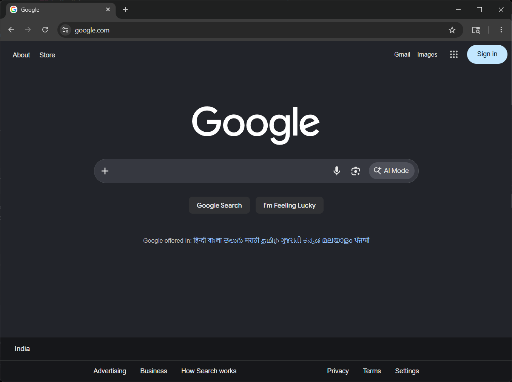
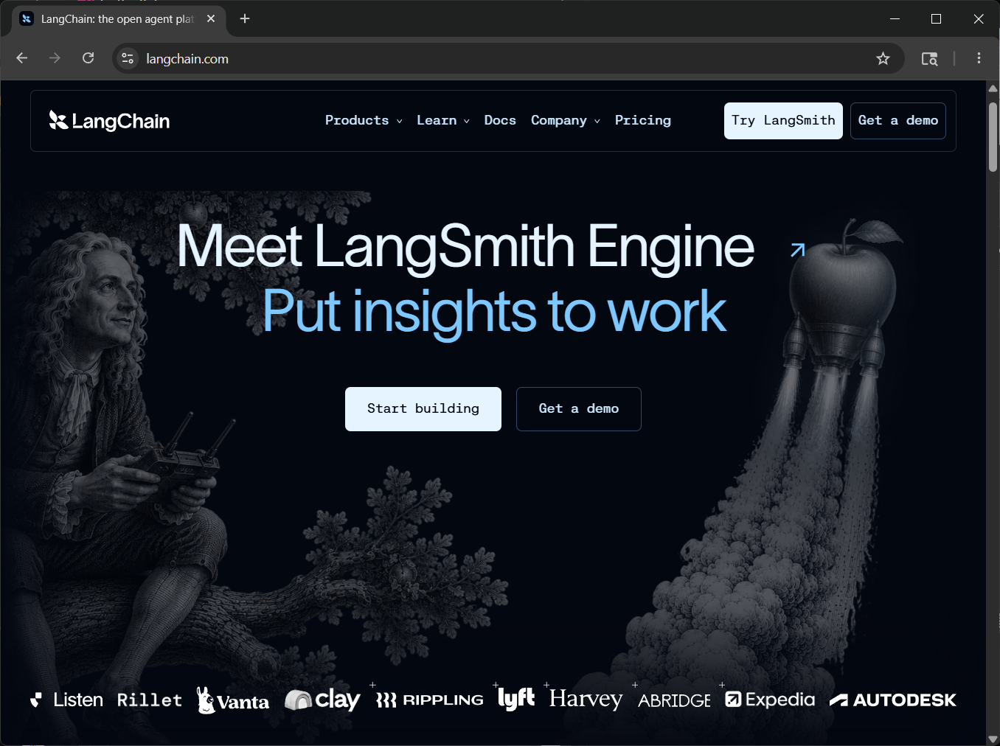
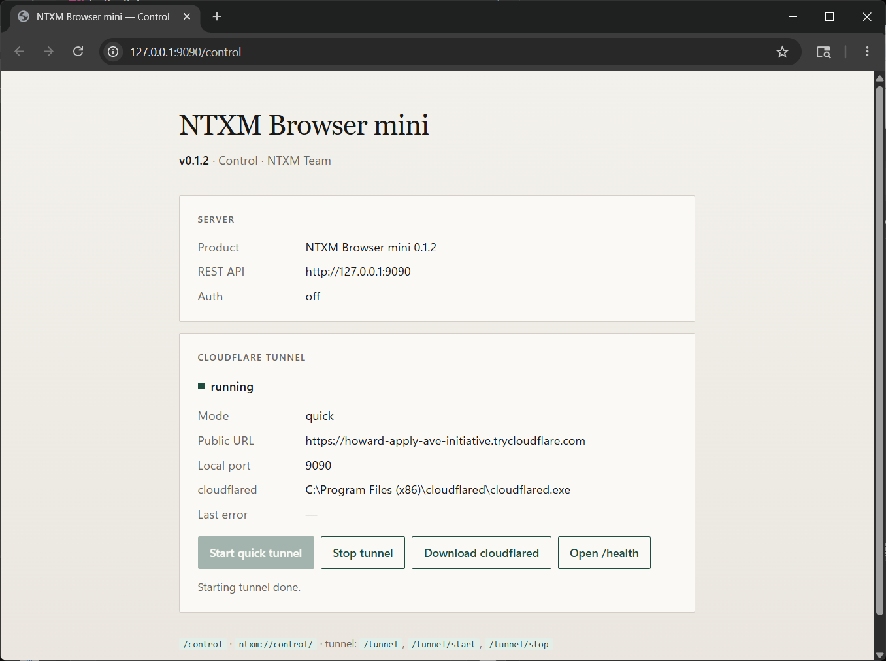
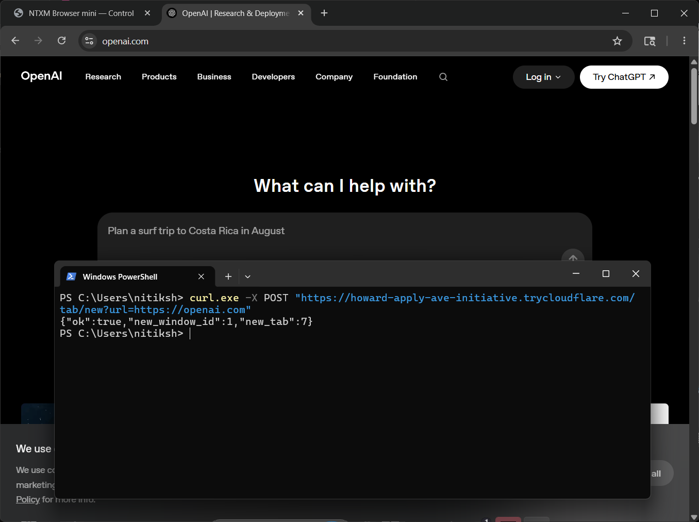

<p align="center">
  
</p>

<h1 align="center">NTXM Browser mini</h1>

<p align="center">
  <strong>A real Chromium browser you can drive with HTTP.</strong><br />
  Local REST API · Windows &amp; macOS · Cloudflare tunnel · Built for agents, QA, and automation
</p>

<p align="center">
  <a href="https://github.com/techxcelerate/browser-mini/releases/latest"></a>
  &nbsp;
  
  &nbsp;
  
  &nbsp;
  
</p>

<p align="center">
  <a href="https://github.com/techxcelerate/browser-mini/releases/latest"><strong>Download installer</strong></a>
  ·
  <a href="#quick-start">Quick start</a>
  ·
  <a href="#automation-api">API</a>
  ·
  <a href="#license">License</a>
</p>

---

<p align="center">
  
</p>

<p align="center"><em>Full Chromium browsing — not a headless stub.</em></p>

---

## Why it exists

Most automation stacks bolt a driver onto someone else’s browser.  
**NTXM Browser mini** is the browser *and* the control plane: a native desktop Chromium app with a built-in REST server on `http://127.0.0.1:9090`.

Open windows and tabs, navigate, read page HTML, and expose the API remotely with Cloudflare — from any language that can speak HTTP.

---

## Highlights

| | |
|---|---|
| **Real Chromium** | CEF Chrome-runtime — modern sites, extensions-ready chrome UI |
| **REST out of the box** | No Selenium, no Playwright install — just `curl` or `requests` |
| **Windows & tabs** | Create, focus, and close windows and tabs by id |
| **Control panel** | Built-in `ntxm://control` / `http://127.0.0.1:9090/control` |
| **Remote access** | Optional Cloudflare quick or named tunnel |
| **Local & quiet** | No telemetry — runs on your machine |

---

## Gallery

<p align="center">
  
</p>
<p align="center"><em>Browse the live web like any desktop browser</em></p>

<br />

<p align="center">
  
</p>
<p align="center"><em>Control panel — server status, health, and Cloudflare tunnel</em></p>

<br />

<p align="center">
  
</p>
<p align="center"><em>Drive it remotely — one POST opens a tab through your tunnel</em></p>

---

## Download

**Latest release: [v0.1.4](https://github.com/techxcelerate/browser-mini/releases/latest)**

| Platform | Asset | Notes |
|----------|-------|--------|
| **Windows** (x64) | [`NTXM_Browser_Mini_Setup_0.1.4.exe`](https://github.com/techxcelerate/browser-mini/releases/download/v0.1.4/NTXM_Browser_Mini_Setup_0.1.4.exe) | NSIS installer — silent: `/S` |
| **macOS** (Apple Silicon) | [`NTXM_Browser_Mini_Setup_0.1.4.dmg`](https://github.com/techxcelerate/browser-mini/releases/download/v0.1.4/NTXM_Browser_Mini_Setup_0.1.4.dmg) | Drag-and-drop disk image |
| **macOS** (Apple Silicon) | [`NTXM_Browser_Mini_Setup_0.1.4.pkg`](https://github.com/techxcelerate/browser-mini/releases/download/v0.1.4/NTXM_Browser_Mini_Setup_0.1.4.pkg) | Installer package |

Same product and REST API on both platforms — `http://127.0.0.1:9090`.

> This repository hosts **releases and docs only** — not the product source code.

---

## Quick start

1. Install and launch **NTXM Browser mini**.
2. The control page opens automatically (`http://127.0.0.1:9090/control`).
3. Try the API:

```bash
# Health
curl.exe http://127.0.0.1:9090/health

# List windows & tabs
curl.exe http://127.0.0.1:9090/windows
curl.exe http://127.0.0.1:9090/tabs

# Open a tab
curl.exe -X POST "http://127.0.0.1:9090/tab/new?url=https://example.com"

# Navigate the active tab
curl.exe -X POST "http://127.0.0.1:9090/navigate?window=1" -d "https://news.ycombinator.com"

# Read URL / HTML
curl.exe "http://127.0.0.1:9090/url?window=1"
curl.exe "http://127.0.0.1:9090/content?window=1"
```

In-app docs live at `http://127.0.0.1:9090/` while the browser is running.

---

## Automation API

**Base URL:** `http://127.0.0.1:9090`  
Target with `?window=` and `?tab=` (defaults to the active window / tab).

### Essentials

| Method | Path | Purpose |
|--------|------|---------|
| `GET` | `/health` | Health + product version |
| `GET` | `/windows` | List windows |
| `POST` | `/window/new` | New window (`?url=` or body) |
| `POST` | `/window/focus` | Focus a window |
| `POST` | `/window/close` | Close a window (all its tabs) |
| `GET` | `/tabs` | List tabs |
| `POST` | `/tab/new` | New tab |
| `POST` | `/tab/activate` | Activate a tab |
| `POST` | `/tab/close` | Close a tab |
| `POST` | `/navigate` | Navigate |
| `POST` | `/back` · `/forward` · `/reload` | History / reload |
| `GET` | `/url` | Current URL |
| `GET` | `/content` | Page HTML |
| `GET` · `POST` | `/tunnel` · `/tunnel/start` · `/tunnel/stop` | Cloudflare tunnel |

### Tiny Python example

```python
import requests

BASE = "http://127.0.0.1:9090"

print(requests.get(f"{BASE}/health").json())

r = requests.post(f"{BASE}/tab/new", params={"url": "https://example.com"})
print(r.json())  # {"ok": true, "new_window_id": 1, "new_tab": ...}

html = requests.get(f"{BASE}/content", params={"window": 1}).text
print(html[:200])
```

### Remote access

Enable a Cloudflare quick or named tunnel from the control page (or `settings.json`).  
With a public URL you can call the same endpoints from another machine — turn **auth** on before exposing the API.

---

## Requirements

- **Windows** 10 / 11 (x64), or **macOS** on Apple Silicon (arm64)
- Release packages include Chromium / CEF runtime assets
- Optional: [cloudflared](https://developers.cloudflare.com/cloudflare-one/connections/connect-apps/install-and-setup/installation/) for remote tunnel (`cloudflared` / `cloudflared-darwin-arm64`)

---

## License

NTXM Browser mini is **proprietary** software. All rights reserved · NTXM Team.

- This repo distributes **binaries and documentation**, not source code.
- Do not reverse engineer, decompile, repackage, or redistribute without written permission.
- Provided as-is for personal and professional browsing, testing, and automation.

---

<p align="center">
  <sub>NTXM Browser mini · v0.1.4 · NTXM Team</sub>
</p>
